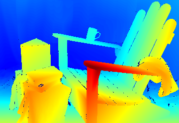
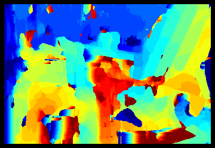
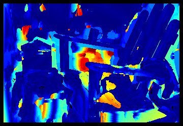
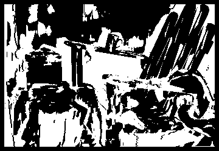
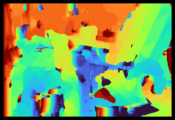
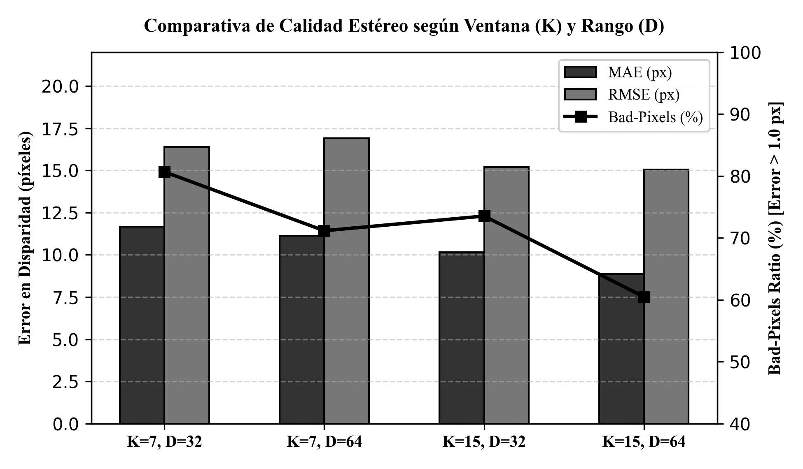
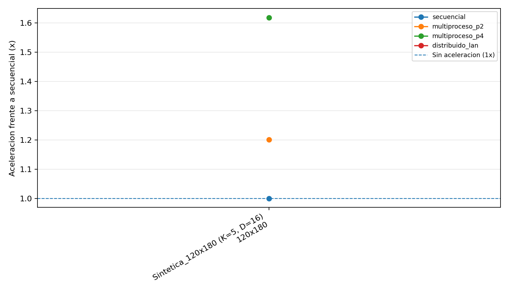
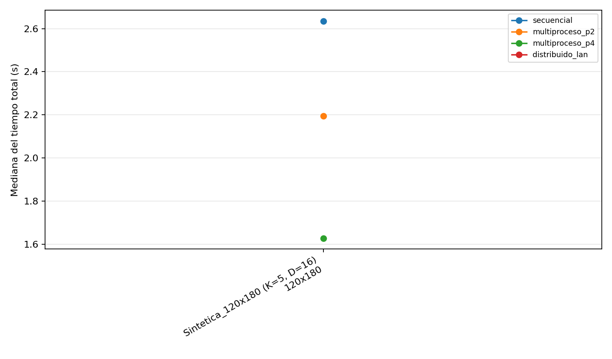

# Proyecto 5: Visión Estéreo Paralela y Distribuida
### Universidad Peruana Cayetano Heredia (UPCH)
**Facultad de Ciencias e Ingeniería — Computación Paralela y Distribuida (Ciclo 2026-II)**

[](https://www.python.org/downloads/)
[]()
[](https://zeromq.org/)
[]()

Investigación experimental sobre la aceleración computacional, sobrecostos de comunicación y análisis del punto de cruce en la estimación de disparidad estéreo densa mediante correlación por ventanas (algoritmo SAD).

---

## 👥 Integrantes y Docentes

* **Autores:**
  * **Alexander Manosalva Peralta** (Línea base secuencial, verificación de equivalencia numérica, evaluación de calidad estéreo y reconstrucción 3D).
  * **Jhunior Fernando Herrera Valeriano** (Particionamiento por franjas con halos, multiprocessing, capa distribuida ZeroMQ e instrumentación de tiempos).
* **Docentes Guía:**
  * Wilfredo Evangelista Falcón
  * Emanuel Ortiz Ortiz

---

## 📌 Resumen del Proyecto

El proyecto evalúa cuantitativamente la escalabilidad y los límites de rendimiento del algoritmo de **Suma de Diferencias Absolutas (SAD)** sobre pares estéreos rectificados del repositorio oficial **Middlebury Stereo 2014** (escena *Adirondack* en resoluciones *Quarter* y *Half*).

Se contrastan cuatro modalidades computacionales:
1. **Línea Base Secuencial:** Ejecución en un único hilo de CPU.
2. **Paralelismo Local Multiproceso (P2):** Concurrencia en memoria compartida sobre 2 núcleos de CPU.
3. **Paralelismo Local Multiproceso (P4):** Concurrencia en memoria compartida sobre 4 núcleos de CPU.
4. **Sistema Distribuido sobre Red LAN:** Clúster de dos nodos heterogéneos interconectados mediante sockets ZeroMQ sobre TCP/IP (PC de sobremesa como Maestro + Computadora portátil como Trabajador).

```
                                ARQUITECTURA DEL SISTEMA
                                           │
         ┌─────────────────────────────────┼─────────────────────────────────┐
         ▼                                 ▼                                 ▼
1. LÍNEA BASE SECUENCIAL        2. PARALELO MULTIPROCESO           3. DISTRIBUIDO ZEROMQ
  • 1 núcleo de CPU              • 2 y 4 procesos (P2, P4)         • Topología Master-Worker
  • Cómputo monolítico           • Franjas con halos r=floor(K/2)  • Sockets REQ/REP sobre TCP
  • Patrón de referencia         • Memoria compartida spawn        • Búferes contiguos NumPy
```

---

## 🚀 Hallazgos Experimentales Clave

Tras la ejecución de **520 corridas formales cronometradas** (10 repeticiones por configuración) y **52 pruebas de calentamiento** (*warm-ups*):

1. **Ganador de Rendimiento — Multiprocesamiento P4:**  
   Alcanzó una aceleración de hasta **3.712x** y una eficiencia paralela de **92.8%** en la configuración más pesada (*Quarter* 224×352, $K=15, D=64$).
2. **Cuello de Botella del Sistema Distribuido LAN ($S < 1.0$):**  
   La modalidad distribuida obtuvo aceleraciones sub-unitarias (**0.68x a 0.84x** frente al secuencial). No se observó un punto de cruce favorable para LAN dentro del rango evaluado.
   * **Heterogeneidad de CPU (Efecto Straggler):** La computadora portátil (Ryzen 7 7735HS) tardó en promedio **2.5 a 2.7 veces más** que la PC de sobremesa (Core i7-12700KF) en procesar la misma franja de imagen. El maestro rápido permanece ocioso esperando al nodo lento para ensamblar el mapa.
   * **Sobrecosto de red:** La serialización binaria contigua y la transmisión TCP sobre Wi-Fi añaden una penalización temporal que supera el beneficio de repartir la carga.
3. **Equivalencia Numérica Absoluta (0.000000 px):**  
   La descomposición horizontal con halos contextuales de radio $r = \lfloor K/2 \rfloor$ garantiza una concordancia de máscara del **100.00%** y una diferencia absoluta máxima de disparidad estrictamente nula frente al secuencial.
4. **Calidad Estéreo:**  
   Evaluando sobre una máscara común de 332,812 píxeles frente al Ground Truth oficial, la configuración $K=15, D=64$ ofreció el mejor compromiso global, reduciendo el error medio (MAE) a **8.87 px** y la tasa de píxeles erróneos (*Bad Pixels*) al **60.49%**.

---

## 📊 Galería de Resultados y Evidencia Visual

| Disparidad Ground Truth Oficial (Middlebury) | Estimación SAD ($K=15, D=32$, Turbo) |
| :---: | :---: |
|  |  |

| Mapa Espacial de Error Residual ($|d_{\text{calc}} - d_{\text{gt}}|$) | Máscara de Bad-Pixels (Error $> 1.0\text{ px}$) |
| :---: | :---: |
|  |  |

| Reconstrucción Métrica 3D de Profundidad ($Z$ en metros) | Comparativa de Error (MAE, RMSE y Bad-Pixels) |
| :---: | :---: |
|  |  |

| Comparativa de Aceleración (*Speedup*) | Tiempos de Ejecución Medianos ($n=10$) |
| :---: | :---: |
|  |  |

---

## 📈 Tabla Consolidada de Rendimiento (13 Configuraciones)

Medianas de tiempo extremo a extremo en segundos ($n=10$ por celda):

| Resolución / ROI | Ventana ($K$) | Rango ($D$) | Secuencial (s) | P4 (s) | Speedup P4 | LAN (s) | Speedup LAN |
| :--- | :---: | :---: | :---: | :---: | :---: | :---: | :---: |
| **Q 96×160** | 7 | 32 | 1.2553 | 0.5299 | **2.369x** | 1.8268 | 0.687x |
| **Q 160×256** | 7 | 32 | 3.6571 | 1.1723 | **3.120x** | 4.8085 | 0.761x |
| **Q 224×352** | 7 | 32 | 7.3591 | 2.1511 | **3.421x** | 9.8125 | 0.750x |
| **Q 96×160** | 7 | 64 | 2.2659 | 0.7965 | **2.845x** | 2.9211 | 0.776x |
| **Q 160×256** | 7 | 64 | 6.9276 | 2.0167 | **3.435x** | 8.8211 | 0.785x |
| **Q 224×352** | 7 | 64 | 14.2527 | 3.9025 | **3.652x** | 17.8356 | 0.799x |
| **Q 96×160** | 15 | 32 | 1.2370 | 0.5492 | **2.252x** | 1.6075 | 0.769x |
| **Q 160×256** | 15 | 32 | 3.7813 | 1.2625 | **2.995x** | 4.8308 | 0.783x |
| **Q 224×352** | 15 | 32 | 7.7976 | 2.3077 | **3.379x** | 9.9406 | 0.784x |
| **Q 96×160** | 15 | 64 | 2.1067 | 0.8125 | **2.593x** | 2.7335 | 0.771x |
| **Q 160×256** | 15 | 64 | 7.4266 | 2.0947 | **3.546x** | 10.9092 | 0.681x |
| **Q 224×352** | 15 | 64 | 15.6984 | 4.2291 | **3.712x** | 18.6155 | 0.843x |
| **H 192×320** | 15 | 64 | 10.6907 | 3.2189 | **3.321x** | 14.2261 | 0.751x |

---

## 🛠️ Instalación y Requisitos

El proyecto requiere **Python 3.10 o superior** en Windows o Linux.

```powershell
# 1. Clonar el repositorio
git clone https://github.com/Joota16/stereo-disparidad.git
cd stereo-disparidad

# 2. Crear y activar entorno virtual
python -m venv .venv
.\.venv\Scripts\Activate.ps1

# 3. Instalar dependencias
pip install -r requirements-dev.txt
```

---

## 🧪 Guía Rápida de Ejecución

### 1. Ejecutar la Suite Completa de Pruebas (61 Tests)
Valida unitariamente la E/S, algoritmos SAD, particionado con halos, sockets ZeroMQ, equivalencia y métricas:
```powershell
pytest
```
*Resultado esperado:* `61 passed in ~5s`.

---

### 2. Probar la Equivalencia Numérica Estricta (T17)
Compara píxel a píxel la línea base secuencial frente a la ejecución distribuida ZeroMQ:
```powershell
python -m src.distributed.verify_equivalence_distributed
```
*Resultado esperado:* `Diferencia absoluta maxima: 0.000000 px | Coincidencia de mascara: 100.0% [APROBADO]`.

---

### 3. Evaluar Calidad Estéreo y Generar Reconstrucción 3D (T20)
Compara contra el Ground Truth de Middlebury y genera mapas de error y profundidad en metros:
```powershell
python -m experiments.evaluate_quality --windows 7 15 --d-max 32
```
*Resultado:* Guarda los mapas visuales en `results/t20_quality/` e imprime la tabla de MAE, RMSE y Bad-Pixels.

---

### 4. Ejecutar el Benchmark Rápido y Generar Gráficos (T19 y T21)
Mide el tiempo de las 4 modalidades y genera las gráficas comparativas de aceleración:
```powershell
# Benchmark de rendimiento
python -m experiments.run_benchmark_grid --scope quick --reps 1 --warmup 0 --output-runs results\mi_prueba\runs.csv --output-summary results\mi_prueba\summary.csv

# Generador de gráficos de Speedup y tiempos
python -m experiments.analyze_t21 --runs results\mi_prueba\runs.csv --output results\mi_prueba\t21
```

---

### 5. Despliegue Distribuido en Dos Máquinas Reales (T15 y T18)
1. **En la Computadora Portátil (Nodo Trabajador):**
   ```powershell
   python -m src.distributed.worker --bind tcp://0.0.0.0:5555
   ```
2. **En la Estación de Sobremesa (Nodo Maestro):**
   ```powershell
   python -m experiments.run_benchmark_grid --connect tcp://<IP_DE_LA_LAPTOP>:5555 ...
   ```

*Nota:* Asegurarse de abrir el puerto en el Firewall de Windows con:  
`netsh advfirewall firewall add rule name="ZeroMQ_SAD_5555" dir=in action=allow protocol=TCP localport=5555`.

---

## 📁 Estructura del Repositorio

```text
├── configs/            Configuraciones de ejecución y red
├── data/               Pares estéreos y ground truth de Middlebury 2014
├── docs/               Documentación técnica, bitácora y cierres experimentales (T01 a T22)
├── experiments/        Scripts reproducibles de benchmarking, calidad y consolidación
├── figures/            Gráficos estadísticos y mapas visuales generados
├── results/            Registros CSV de corridas y resúmenes estadísticos (ignorado por Git)
├── scripts/            Herramientas de diagnóstico de red y validación de nodos
├── src/
│   ├── common/         Módulos de E/S, lectura de PFM, métricas y temporizadores
│   ├── distributed/    Maestro, trabajador y protocolo binario multipartes ZeroMQ
│   ├── parallel/       Particionamiento con halos y multiprocesamiento local
│   └── stereo/         Núcleo SAD secuencial y validación de línea base
├── tests/              Suite automatizada de 61 pruebas unitarias e integradas
└── tools/              Herramientas auxiliares y generador del informe académico en Word
```

---

## 📚 Referencias Bibliográficas

* Amdahl, G. M. (1967). *Validity of the single processor approach to achieving large scale computing capabilities*. AFIPS '67, pp. 483–485.
* Gustafson, J. L. (1988). *Reevaluating Amdahl's law*. Communications of the ACM, 31(5), pp. 532–533.
* Hamzah, R. A., & Ibrahim, H. (2016). *Literature survey on stereo vision disparity map algorithms*. Journal of Sensors, 2016, 1–23.
* Hirschmüller, H. (2008). *Stereo processing by semiglobal matching and mutual information*. IEEE TPAMI, 30(2), pp. 328–341.
* Kuijpers, P., Fias, P., & Van Horebeek, I. (1996). *Stereo vision and 3D reconstruction on a distributed memory system*. PDPTA '96, pp. 1120–1129.
* Ralha, R., Falcão, G., Andrade, J., Antunes, M., Barreto, J. P., & Nunes, U. (2015). *Distributed dense stereo matching for 3D reconstruction using parallel-based processing advantages*. IEEE ICASSP, pp. 1126–1130.
* Scharstein, D., & Szeliski, R. (2002). *A taxonomy and evaluation of dense two-frame stereo correspondence algorithms*. IJCV, 47(1), pp. 7–42.
* Scharstein, D., et al. (2014). *High-resolution stereo datasets with subpixel-accurate ground truth*. GCPR 2014, LNCS vol 8753, pp. 31–42.
